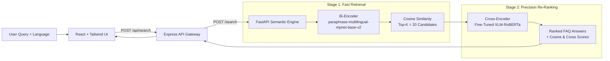

# Multilingual Semantic Textual Similarity & Hybrid FAQ Search

**End-to-end multilingual Semantic Textual Similarity (STS) research and real-time FAQ search engine combining dense Bi-Encoder retrieval with a fine-tuned XLM-RoBERTa Cross-Encoder re-ranker.**

`Python 3.10+` · `PyTorch` · `Hugging Face Transformers` · `Sentence-Transformers` · `FastAPI` · `React` · `TypeScript` · `MIT License`

[Interactive Dashboard](docs/index.html) • [System Architecture](docs/architecture.md) • [10-Language Benchmarks](docs/benchmarks.md) • [Project Evolution](docs/project-evolution.md)

## Overview

Measuring semantic equivalence across languages is foundational to modern information retrieval, question answering, and duplicate detection. This repository brings together the complete NLP engineering lifecycle:

1. **Multilingual STS Benchmarking (10 Languages, 86,280 Sentence Pairs)** — Fine-tuned and evaluated three multilingual transformer architectures (**XLM-RoBERTa**, **mBERT**, and **DistilBERT**) on the [`PhilipMay/stsb_multi_mt`](https://huggingface.co/datasets/PhilipMay/stsb_multi_mt) benchmark across German, English, Spanish, French, Italian, Dutch, Polish, Portuguese, Russian, and Chinese.
2. **Two-Stage Hybrid Retrieval & Re-Ranking Engine** — Paired a fast multilingual Bi-Encoder (`paraphrase-multilingual-mpnet-base-v2`) for high-recall candidate retrieval with the top-performing fine-tuned **XLM-RoBERTa** Cross-Encoder for token-level re-ranking, achieving sub-3-second CPU latency with zero external API dependencies.
3. **Full-Stack Multilingual FAQ Search App & Interactive Dashboard** — Delivered a FastAPI inference microservice, an Express + React + Tailwind web application over the [`clips/mfaq`](https://huggingface.co/datasets/clips/mfaq) corpus (EN, DE, ES, FR, IT), and an interactive GitHub Pages analytics & search dashboard.

## Key Highlights

- **Best Model (`XLM-RoBERTa`)**: `0.8700` Dev Pearson / Spearman (`0.5700` MSE) and **`0.8273` Test Pearson / `0.8169` Test Spearman** (`0.9588` Cosine, `0.7521` MSE) across **13,790** multilingual test pairs.
- **Consistent Cross-Lingual Dominance**: Outperforms both mBERT and DistilBERT on **all 10 languages individually**, from English (`0.8483` Pearson) and German (`0.8359`) to Chinese (`0.8290`) and Polish (`0.8129`).
- **Local-First Hybrid Search**: Pre-computes L2-normalized 768-dim FAQ embeddings at startup, retrieves Top-20 candidates via cosine similarity, and re-ranks them with full cross-attention in under 3 seconds on consumer CPUs.
- **Reproducible on GitHub**: Includes a zero-dependency benchmark evaluator (`experiments/scripts/evaluate_predictions.py`), automated `unittest` integrity checks, and GitHub Actions CI + Pages workflows.

## System Architecture



See [docs/architecture.md](docs/architecture.md) for complexity analysis and the comparative trade-off study against Pure Cross-Encoder, Pure Bi-Encoder, BM25, and Cloud LLMs.

## Benchmark Results (`stsb_multi_mt`)

All three transformers were fine-tuned for 3 epochs (`lr = 2e-5`, `batch_size = 16`, `AdamW`, max sequence length `128`) on **57,490** multilingual training pairs and evaluated on **15,000** validation pairs and **13,790** test pairs across 10 languages.

### Overall Model Comparison

| Model | Dev Pearson | Dev Spearman | Dev MSE | Test Pearson | Test Spearman | Test Cosine | Test MSE | Test MAE | Test RMSE |
| :--- | ---: | ---: | ---: | ---: | ---: | ---: | ---: | ---: | ---: |
| **XLM-RoBERTa** | **0.8700** | **0.8700** | **0.5700** | **0.8273** | **0.8169** | **0.9588** | **0.7521** | **0.6390** | **0.8672** |
| **mBERT** | 0.8500 | 0.8500 | 0.6500 | 0.8030 | 0.7955 | 0.9537 | 0.8444 | 0.6902 | 0.9189 |
| **DistilBERT** | 0.8100 | 0.8070 | 0.7900 | 0.7727 | 0.7632 | 0.9467 | 0.9490 | 0.7247 | 0.9742 |

### Per-Language Test Pearson Correlation (1,379 Pairs / Language)

| Model | EN | DE | ZH | IT | ES | FR | PT | NL | RU | PL |
| :--- | ---: | ---: | ---: | ---: | ---: | ---: | ---: | ---: | ---: | ---: |
| **XLM-RoBERTa** | **0.8483** | **0.8359** | **0.8290** | **0.8286** | **0.8275** | **0.8255** | **0.8244** | **0.8216** | **0.8192** | **0.8129** |
| **mBERT** | 0.8246 | 0.8001 | 0.8021 | 0.8120 | 0.8117 | 0.8045 | 0.8056 | 0.7927 | 0.7977 | 0.7872 |
| **DistilBERT** | 0.7995 | 0.7768 | 0.7672 | 0.7759 | 0.7884 | 0.7805 | 0.7687 | 0.7642 | 0.7563 | 0.7510 |

Full per-language Spearman, Cosine, and MSE tables are in [docs/benchmarks.md](docs/benchmarks.md).

## Repository Structure

```text
multilingual-semantic-similarity/
├── .github/workflows/
│   ├── ci.yml                         # Automated benchmark reproduction, tests & web build
│   └── pages.yml                      # Automated GitHub Pages dashboard deployment
├── backend/
│   ├── semantic_engine.py             # FastAPI Bi-Encoder + Cross-Encoder microservice
│   ├── requirements.txt               # Python dependencies
│   └── tests/
│       └── test_evaluate_and_data.py  # Dataset, benchmark & syntax test suite
├── data/
│   └── mfaq/                          # Multilingual FAQ corpora (EN, DE, ES, FR, IT)
├── docs/
│   ├── index.html                     # Interactive GitHub Pages dashboard
│   ├── data/dashboard_data.json       # Precomputed metrics, error histograms & FAQ corpus
│   ├── architecture.md                # Hybrid pipeline & comparative justification
│   ├── benchmarks.md                  # Full 10-language STS evaluation analysis
│   └── project-evolution.md           # Initial outline → interim experiments → final system
├── experiments/
│   ├── notebooks/                     # Fine-tuning notebooks (XLM-RoBERTa, mBERT, DistilBERT)
│   ├── results/                       # 13,790-row test prediction CSVs & JSON summary
│   └── scripts/
│       └── evaluate_predictions.py    # Zero-dependency CLI benchmark evaluator
├── web/
│   ├── client/                        # React + TypeScript + Tailwind + Radix UI frontend
│   ├── server/                        # Express API gateway & MFAQ CSV loader
│   ├── shared/                        # Shared TypeScript schemas
│   └── package.json
├── LICENSE
└── README.md
```

## Quickstart

### 1. Reproduce Benchmarks & Run Tests (Zero External Dependencies)

```bash
# Run the test suite (verifies all 5 MFAQ CSVs, 13,790-row STS test sets, & ranking)
python3 -m unittest discover -s backend/tests -v

# Print the full benchmark table directly from the saved predictions
python3 experiments/scripts/evaluate_predictions.py
```

### 2. Run the Hybrid FastAPI Semantic Engine

1. Fine-tune the XLM-RoBERTa cross-encoder using `experiments/notebooks/xlm_roberta_sts_finetuning.ipynb` (or place your saved checkpoint in `backend/models/xlmroberta_sts_finetuned/`, or override via `CROSS_ENCODER_PATH`).
2. Install Python dependencies and start the microservice:

```bash
cd backend
python3 -m venv .venv && source .venv/bin/activate
pip install -r requirements.txt
python semantic_engine.py
```

The service starts on `http://localhost:8000` with interactive Swagger docs at `http://localhost:8000/docs` and endpoints `GET /health`, `GET /languages`, and `POST /search`.

### 3. Run the Full-Stack Multilingual FAQ Web App

```bash
cd web
npm install
npm run dev
```

Open `http://localhost:8080` to browse FAQs or run real-time semantic queries across English, German, Spanish, French, and Italian.

## Interactive Dashboard (GitHub Pages)

The `docs/` directory hosts a zero-build interactive dashboard featuring:

- **Model Benchmark Arena** — Interactive Dev & Test metric comparisons across XLM-RoBERTa, mBERT, and DistilBERT.
- **10-Language Performance Matrix** — Sortable per-language Pearson, Spearman, and MSE visualizations.
- **Prediction Error Distribution** — Residual error histograms computed over all 13,790 test sentence pairs.
- **Sentence-Pair Prediction Explorer** — Inspect real multilingual test pairs comparing human gold scores against all three models.
- **Multilingual FAQ Search Playground** — Live client-side search across 979 curated MFAQ entries in 5 languages.

## Author & License

**Rajath Gadagkar** — [rajathgadagkar@gmail.com](mailto:rajathgadagkar@gmail.com)

Released under the [MIT License](LICENSE).
